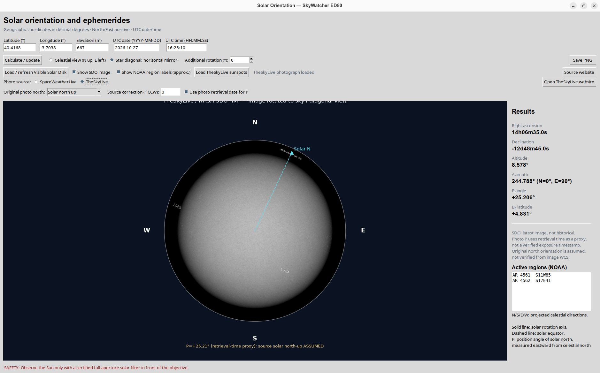

# Solar Orientation

**Solar Orientation** is a desktop Python application for displaying the apparent orientation of the Sun at a chosen observing site and UTC date/time. It is designed for astronomical observers using a telescope such as the **Sky-Watcher Evostar ED80**, with or without a 90° star diagonal.

The application provides a solar disc diagram with projected celestial cardinal directions, the solar rotation axis, the projected solar equator, and solar orientation angles. It also calculates the Sun's equatorial and horizontal coordinates.



## Features

- Graphical user interface in **English**, built with Tkinter.
- Input for observer **latitude**, **longitude**, **elevation**, **UTC date**, and **UTC time**.
- Solar **right ascension** (RA), **declination** (Dec), **altitude**, and **azimuth**.
- Solar **P angle** (position angle of the north solar rotation pole) and **B₀** (heliographic latitude of the disc centre).
- Solar disc plot with **celestial N, S, E, W** directions, **solar rotation axis**, **solar poles** and projected **solar equator**.
- **Celestial view** (north up, east left) and a **horizontal mirror** view to approximate a single-reflection star diagonal.
- User-adjustable additional field rotation, in degrees.
- Export of the diagram to a **PNG** file.
- **Load / refresh Visible Solar Disk**: download and display the current SpaceWeatherLive SDO/HMI intensitygram in the solar plot without blocking the GUI.
- **Show SDO image** toggle, download status, source website link, and graceful connection-error reporting.
- Fetch NOAA active-region IDs and heliographic locations from the SpaceWeatherLive page; display the list and optional **approximate** markers on the high-resolution SDO disk. Markers are not WCS registered and may differ from the image capture time.

## Requirements

- Python 3.10 or newer (Python 3.13 is suitable with compatible dependency versions).
- Tkinter, usually supplied by the operating system's `python3-tk` package on Ubuntu.
- NumPy, Matplotlib, Astropy, Pillow and Beautiful Soup 4 (see `requirements.txt`).
- An internet connection for the optional solar image.

## Installation (Ubuntu / Debian)

```bash
sudo apt update
sudo apt install python3 python3-venv python3-tk

python3 -m venv .venv
source .venv/bin/activate
pip install -r requirements.txt
```

## Run

```bash
python3 solar_orientation.py
```

## Using the application

1. Enter the observer latitude and longitude in **decimal degrees** (north and east are positive; west and south are negative).
2. Enter the observing elevation in metres.
3. Enter the observing **UTC date** in `YYYY-MM-DD` format and **UTC time** in `HH:MM:SS` format. **Do not enter local civil time** unless you have converted it to UTC.
4. Select **Calculate / update** to compute the ephemerides and display the solar disc.
5. Select **Celestial view** for north-up/east-left celestial coordinates, or **Star diagonal: horizontal mirror** for a single-mirror reflection of that view.
6. Adjust **Additional rotation** to match the physical orientation of your diagonal and eyepiece, if necessary.
7. Click **Load / refresh Visible Solar Disk** to fetch the newest SDO/HMI visible-light image. Select **Show SDO image** to toggle it. The downloaded image is retained in memory until refreshed or the app closes.
8. Use **Source website** to view the original SpaceWeatherLive page in a browser.
9. Select **Save PNG** to export the current plot.

The startup location is prefilled with approximate coordinates for Madrid, Spain; change them to your actual observing site. The initial date and time are illustrative defaults, not a live clock.

## Coordinate and orientation conventions

| Value | Interpretation |
| --- | --- |
| Right ascension / declination | Apparent geocentric Sun coordinates returned by Astropy (`get_sun`, GCRS) |
| Altitude | Angle above the observer's astronomical horizon |
| Azimuth | Measured clockwise from north: N = 0°, E = 90°, S = 180°, W = 270° |
| P angle | Position angle of the solar north pole, measured eastward from celestial north |
| B₀ | Heliographic latitude of the centre of the visible solar disc |

The diagram is a **schematic geometric representation** of the solar disc and rotation axis. The equator is represented as a projected great circle. The code uses fixed IAU/J2000 pole coordinates (RA = 286.13°, Dec = +63.87°) for an approximate solar orientation calculation.

**Optical orientation caveat:** A diagonal can change the handedness of the image, and rotating the diagonal or the telescope changes the final field orientation. The mirrored-view option and manual rotation are visual aids, **not an automatic calibration of the eyepiece orientation**. A prism or diagonal with different optical properties may produce a different transformation. Check real N/E directions experimentally before using the plot for positional measurements.

**Accuracy caveat:** Altitude and azimuth are computed with atmospheric refraction disabled. Astropy uses its configured Earth orientation data; bundled data may give reduced precision for dates outside their validity. The program is intended as an observing/planning aid rather than a precision solar astrometry package. It does not predict sunspot locations. The optional SDO/HMI image is a recently published real observation, not a reconstruction for the date you entered.

## Visible Solar Disk image: source and limitations

The optional **Visible Solar Disk** image is downloaded from `https://www.spaceweatherlive.com/images/SDO/SDO_HMIIF_1024.jpg`, linked on the [SpaceWeatherLive sunspot-regions page](https://www.spaceweatherlive.com/es/actividad-solar/regiones-de-manchas-solares.html). SpaceWeatherLive attributes the original intensitygram to NASA Solar Dynamics Observatory and its AIA, EVE and HMI teams. The source page describes approximately hourly updates; actual image availability and freshness depend on the provider.

**Important:** the selected observation date/time controls the calculated solar geometry, **not** the downloaded image. The SDO photo is shown in its original pixel orientation. When the SDO photo is displayed, the theoretical coordinate overlay is hidden. Active-region markers can be enabled, but are approximate projections of NOAA heliographic positions, assuming a solar-north-up image; the live JPEG has no WCS calibration, may have a different capture time, and does not obey the optical mirror/rotation controls. Do not use the photo for precise spot coordinates. If the web provider changes the image path or restricts automated access, the download may fail; the original geometric drawing remains available.

Images are third-party content and are **not licensed under this project’s CC BY 4.0 license**. Attribute their respective owners and review their usage policies before redistribution. The PNG export may include third-party imagery when the image option is enabled.

## Project files

```text
solar_orientation_ed80.py   # English GUI application
requirements.txt            # Python dependencies
README.md                   # This documentation
LICENSE                     # CC BY 4.0 license text
```

## Safety: observing the Sun

**Never point a telescope at the Sun without a suitable, undamaged, certified full-aperture solar filter securely mounted in front of the objective.** Never look through an unfiltered ED80 or use an ordinary star diagonal as a substitute for a solar filter. Inspect the filter and its mounting before each session. Use a proper solar filter with the instrument, and follow the manufacturer's instructions.

## License

**Creative Commons Attribution 4.0 International (CC BY 4.0).**

You may share and adapt this project, including for commercial purposes, provided that you give appropriate credit, link to the license, and indicate if changes were made. See `LICENSE` and the full license at:

https://creativecommons.org/licenses/by/4.0/

**Suggested attribution:** `Solar Orientation ED80 — original project contributors, licensed under CC BY 4.0. Changes, if any, indicated.` Replace the attribution with the actual author/project name when publishing the repository. No particular endorsement is implied by attribution.

## Credits and dependencies

The application uses [Astropy](https://www.astropy.org/), [NumPy](https://numpy.org/), [Matplotlib](https://matplotlib.org/), [Pillow](https://python-pillow.org/), and Python's Tkinter GUI toolkit. Image credits: NASA/SDO and SpaceWeatherLive, subject to their respective terms. Third-party packages remain subject to their own respective licenses.

## TheSkyLive — Today's Sunspots Activity photograph

The **Load TheSkyLive sunspots** button attempts to download the actual image shown
in the **Today's Sunspots Activity** section of https://theskylive.com/sun-info.
Unlike SpaceWeatherLive's JPEG, the TheSkyLive image URL is discovered from the
website's current HTML under the section heading, not hardcoded. Use the **Photo
source** controls to switch between independently loaded photographs. The
**Open TheSkyLive website** button opens the original page in a browser.

TheSkyLive credits this photograph to **NASA, SDO, and the HMI Science Team**.
Photographs remain copyrighted by their providers and are not covered by this
application's CC BY 4.0 code license.

**Known limitation:** TheSkyLive can return HTTP 403 or change its page markup.
In that case the program reports the error and does *not* silently replace the
requested photograph with another site's image. The photo is not calibrated to
the calculated ephemeris date/time. NOAA region labels are shown only over the
SpaceWeatherLive image and are approximate.

## Photo orientation correction (new)

Both the SpaceWeatherLive and TheSkyLive solar photographs can be rotated into
an equatorial/celestial view and into the simulated ED80 star-diagonal view.
The **P angle** is the position angle of the solar north pole, measured
counterclockwise from celestial north towards celestial east.

For each source, the interface provides **Original photo north**, offering
**Solar north up** (initial assumption) and **Celestial north up**, and a
separate **Source correction (° CCW)** for any additional image rotation.
With *Solar north up*, the program applies the solar P-angle; with *Celestial
north up*, it does not add P again. Reflection and the user's additional field
rotation are subsequently applied. This prevents an accidental double rotation
when a provider already publishes an image in equatorial orientation.

**Use photo retrieval date for P** estimates the image's P at download time,
independently of the user-selected ephemeris date. Download time is **not** the
actual observation timestamp. It is only a proxy. The app does not currently
retrieve verified image WCS or FITS headers for either source, so the initial
source orientation is a **user-adjustable assumption**, not astrometric
calibration. Confirm which way north points in the provider image before using
it for positional measurements. Solar image labels may have been rendered by
the providers before download; the application rotates those with the image.

The cyan dashed line indicates the calculated direction towards the solar
north pole in the selected final view. It should be interpreted as a reference
rather than verified registration to spots. Separate NOAA labels, when available,
are only approximate and are not suitable for scientific measurements.
